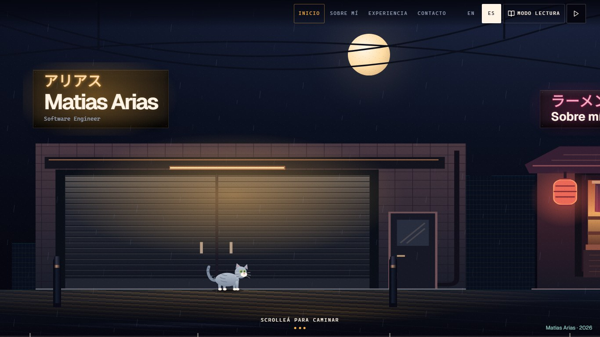
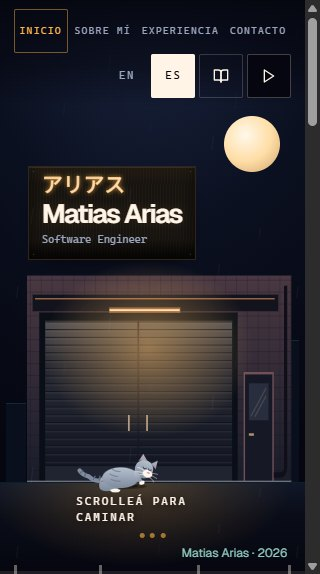

# Callejón de noche · Matias Arias

## Sobre el proyecto

Paris, mi gata, es la verdadera protagonista de este portfolio. Está
representada por la gata que te acompaña por un callejón nocturno de Tokio:
con cada tramo del recorrido, una fachada revela una parte de mi trabajo.
La experiencia está disponible en español e inglés, con un modo lectura
sin animación y una versión que funciona sin JavaScript.

### Escritorio



### Móvil



## Desarrollo

Requiere Node.js 24 y npm. El sitio usa Next.js, React, TypeScript, Tailwind y GSAP.

```sh
npm ci
npm run dev
```

Abrí [localhost:3000](http://localhost:3000): `/` redirige a `/es` y la
versión en inglés está en `/en`. Un enlace como `/es#experience/details`
abre directamente la trayectoria.

## Verificación

```sh
npm run lint
npm run typecheck
npm test
npm run build
npx playwright install chromium firefox webkit
npm run test:e2e
```

Playwright ejecuta 27 pruebas sobre el build de producción en el puerto 3100.
Volvé a compilar si cambió el código o usá `PLAYWRIGHT_BASE_URL` para probar
una preview. Para Lighthouse, dispositivos físicos y lectores de pantalla,
consultá la [guía de revisión](design.md#revisión-manual-antes-de-vercel).
GitHub Actions usa la imagen oficial de Playwright con los navegadores
preinstalados. Corre en cada push y PR y cancela las corridas anteriores del
mismo evento y rama cuando llega una nueva.

CI también ejecuta `npm audit --package-lock-only --include=dev --audit-level=high`.
El job falla ante vulnerabilidades altas o críticas; el artefacto
`npm-audit-report` conserva todos los hallazgos y las correcciones sugeridas
cuando npm las conoce.

## Publicación y recursos

- En Vercel, configurá `SITE_URL` con el origen HTTPS canónico, sin ruta.
  Tras publicar, verificá `/robots.txt`, `/sitemap.xml` y las tarjetas sociales
  de `/es` y `/en`. Las previews usan `noindex`.
- [Contenido bilingüe](src/content/portfolio.ts) · [Dirección visual y estado de revisión](design.md)
  · [Reglas del proyecto](AGENTS.md).
- Para regenerar la imagen social, ejecutá `node scripts/capture-social.mjs`
  con el servidor local activo.
- La pista opcional se define en [`soundtrack.ts`](src/content/soundtrack.ts).
  Su origen informado es un video público de YouTube; no consta una licencia
  de redistribución ni un crédito verificable. Los glifos japoneses derivan
  de Noto Sans JP ([OFL](src/content/NotoSansJP-OFL.txt)).
